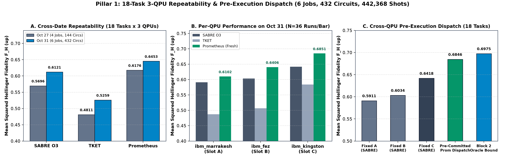

# Scaling and Repeatability of Quantum Compilation Across IBM Processors

*Explore the portfolio: [Prometheus Quantum Overview](https://github.com/PrometheusDynamicsCanada/prometheus-quantum-overview)*

**We tested whether compilation improvements persisted as circuits grew and moved between IBM processors.**

When a compilation method improves small circuits on one chip, teams ask whether that gain repeats across sibling processors, holds up when the baseline compiler gets the **same classical computer time to search hundreds of candidate layouts**, and extends to wider circuits. Across three IBM processors, we kept application-style workloads separate from diagnostic scaling tests:

- **Application-style workloads (`4-17` qubits):** Prometheus improved mean output fidelity by **`+5.42%`** over Qiskit SABRE across repeated multi-processor runs (`+6.67%` with pre-execution processor choice), increased top-decile QAOA optimization hits by **`+15.23%`**, and still led by **`+3.65%` mean (`+14.84%` median)** on unseen workloads when SABRE received equal classical CPU time to test hundreds of randomized trials (`453-trial SABRE` in Table 1A).
- **Diagnostic mirror-circuit tests (`8-101` qubits):** On self-inverting Clifford mirror circuits, Prometheus improved mean bit polarization by **`+10.15%`** overall and **`+41.53%` at 101 qubits** (`0.5379` vs. `0.3801`). These 101-qubit mirror circuits test hardware routing and return polarization rather than an application algorithm.

**[Detailed results](DETAILED_TECHNICAL_REPORT.md) · [Verify the evidence](#verify-the-evidence) · [Discuss a pilot](#discuss-a-pilot)**


*Opening summary (`Pillar 1` application-style workloads across `ibm_marrakesh`, `ibm_fez`, and `ibm_kingston`, `432` circuits): Cross-window repeatability and pre-execution processor dispatch (`+5.42%` fixed-chip fidelity gain, rising to `+6.67%` with processor choice).*

---

## 1. Executive Summary & Principal Comparative Benchmarks

*Campaign Scope:* `17` sequential batch jobs, `1,023` physical circuits (`744` application-style + `279` diagnostic mirror/SPAM), `1,047,552` physical shots, and `326.0` verified QPU charge seconds across 156-qubit `ibm_marrakesh`, `ibm_fez`, and `ibm_kingston`.

> [!NOTE]
> **Metric Conventions:**
> - **Squared Hellinger Fidelity (F_H (↑)):** F_H(P_ideal, P_meas) = (Σ_x √(P_ideal(x) · P_meas(x)))² = F_B².
> - **Classical Bhattacharyya Overlap (F_B (↑)):** F_B = Σ_x √(P_ideal(x) · P_meas(x)) = √F_H (Studio UI screenshots label F_B as `"State Fidelity"`).
> - **Total Variation Distance (TVD (↓)):** 0.5 · Σ_x |P_ideal(x) - P_meas(x)|. Winning values in each row are **bolded**, and summary statistics are explicitly labeled as `*(mean)*` or `*(median)*`.

### Table 1A: Principal 4-Pillar Executive Summary Across All 1,023 Circuits (1,047,552 Shots)

| Campaign Pillar & Cohort Scope | Backends (Jobs / Circs / Shots) | Primary Observable | Qiskit SABRE O3 Baseline | Quantinuum TKET Baseline | Prometheus | % Delta vs. Best Baseline | Native 2Q Gates (↓) (S / T / P) | Compiled Depth (↓) (S / T / P) |
| :--- | :--- | :--- | :---: | :---: | :---: | :---: | :---: | :---: |
| **Pillar 1A: 18-Task 3-QPU Repeat** (54 pairs x 2 blocks) | `ibm_marrakesh`, `ibm_fez`, `ibm_kingston` (6 / 432 / 442,368) | F_H (↑) / F_B (↑) / TVD (↓) | 0.6121 *(mean)* / 0.6837 *(med)* F_H<br>0.7590 F_B / 0.4442 TVD | 0.5259 *(mean)* / 0.6213 *(med)* F_H<br>0.6752 F_B / 0.5305 TVD | **0.6453** *(mean)* / **0.7233** *(med)* F_H<br>**0.7838** F_B / **0.4081** TVD | **+5.42% *(mean)* F_H**<br>**-8.11% *(mean)* TVD** | 122.8 / 169.5 / **108.0**<br>(-12.06% vs. SABRE) | 221.2 / 285.9 / **189.8**<br>(-14.19% vs. SABRE) |
| **Pillar 1B: 18-Task Cross-QPU Dispatch** (18 tasks x 2 blocks) | Best pre-committed QPU per task (6 / 432 / 442,368) | F_H (↑) / F_B (↑) / TVD (↓) | 0.6418 *(mean)* / 0.7601 *(med)* F_H<br>(Best Fixed QPU `ibm_kingston`) | 0.5839 *(mean)* / 0.6602 *(med)* F_H<br>(Best Fixed QPU `ibm_kingston`) | **0.6846** *(mean)* / **0.7806** *(med)* F_H<br>**0.8145** F_B / **0.3676** TVD | **+6.67% *(mean)* F_H**<br>**-11.05% *(mean)* TVD** | 122.8 / 169.5 / **105.4**<br>(-14.20% vs. SABRE) | 221.2 / 285.9 / **189.3**<br>(-14.44% vs. SABRE) |
| **Pillar 2: 8Q-101Q Clifford Mirrors** (28 circs x 3 QPUs + 27 SPAM) | `ibm_marrakesh`, `ibm_fez`, `ibm_kingston` (3 / 279 / 285,696) | Bit Acc (↑) / Pol (↑) / Surv (↑) | 0.7642 *(mean)* / 0.7806 *(med)* Acc<br>0.5284 Pol / 0.1455 Surv | 0.6554 *(mean)* / 0.6666 *(med)* Acc<br>0.3108 Pol / 0.0607 Surv | **0.7910** *(mean)* / **0.8037** *(med)* Acc<br>**0.5820** Pol / **0.1660** Surv | **+10.15% *(mean)* Pol**<br>**+14.09% *(mean)* Surv** | 725.1 / 1492.9 / **682.1**<br>(-5.93% vs. SABRE) | 283.7 / 505.6 / **245.1**<br>(-13.59% vs. SABRE) |
| **Pillar 3: Fixed-Trajectory QAOA Stage 3** (8 graphs x 3 QPUs) | `ibm_marrakesh`, `ibm_fez`, `ibm_kingston` (3 / 216 / 221,184) | Approx. Ratio (↑) / P(C ≥ C_0.9) (↑) | 0.6393 *(mean)* / 0.6228 *(med)* Ratio<br>0.0407 *(mean)* P(C ≥ C_0.9) | 0.6305 *(mean)* / 0.6226 *(med)* Ratio<br>0.0414 *(mean)* P(C ≥ C_0.9) | **0.6444** *(mean)* / **0.6302** *(med)* Ratio<br>**0.0477** *(mean)* P(C ≥ C_0.9) | **+15.23% P(C ≥ C_0.9)**<br>**+0.79% *(mean)* Ratio** | 151.6 / 192.4 / **143.2**<br>(-5.58% vs. SABRE) | 319.9 / 396.6 / **315.5**<br>(-1.37% vs. SABRE) |
| **Pillar 4: 12-Instance Fresh Challenge** (Equal CPU Budget) | `ibm_marrakesh` (5 / 96 / 98,304) | F_H (↑) / F_B (↑) / TVD (↓) | 0.2849 *(mean)* / 0.2349 *(med)* F_H (453 trials)<br>0.2490 *(mean)* F_H (Default 1 trial) | 0.2763 *(mean)* / 0.2170 *(med)* F_H<br>(325 trials) | **0.2953** *(mean)* / **0.2697** *(med)* F_H<br>**0.4788** F_B / **0.5410** TVD | **+3.65% *(mean)* / +14.84% *(med)* vs. 453-Seed SABRE**<br>**+18.59% vs. Default** | **119.3** (S_bud) / 126.0 (T_bud) / 124.4 (Prom) / 134.6 (S_def) | **230.4** *(mean)* (S_bud) / **210.0** *(med)* (Prom) |

<details>
<summary><strong>Expand Table 1B: Complete 17-Job Hardware Ledger, Pre-Execution SHA-256 Commitments & Runtime Accounting (326.00 s Verified Charge Time)</strong></summary>

All 17 jobs were executed sequentially with `execution.rep_delay = 0.00025 s` (250 us) and server-side `max_execution_time` guards. Pre-execution commitments were cryptographically locked prior to each pillar:
- **Pillar 1 Commitment SHA-256:** `f3135c8524a6bb210e589a56495f50ef6878ee9214957e5082e1df1118ff726a` ([`data/pillar1_repeat_and_dispatch/commitments_p1_repeat_fresh_stale.json`](data/pillar1_repeat_and_dispatch/commitments_p1_repeat_fresh_stale.json))
- **Pillar 2 Commitment SHA-256:** `6da6fbb1504ec30b1482fb110bd111ee01279ef3be2959edbc2a9881a157d84e` ([`data/pillar2_clifford_mirror_8q_101q/commitments_p2_clifford_mirror.json`](data/pillar2_clifford_mirror_8q_101q/commitments_p2_clifford_mirror.json))
- **Pillar 3 Commitment SHA-256:** `92e56d749e1b90cf76a6ff699ee9f814ce74c903628cf54ab00838f9f8e88001` ([`data/pillar3_qaoa_trajectory/commitments_p3_qaoa_trajectory.json`](data/pillar3_qaoa_trajectory/commitments_p3_qaoa_trajectory.json))
- **Pillar 4 Commitment SHA-256:** `d633286bdb7e5cb9436675a620911b208f7df23cc49e27e74645ff2eb63c8b78` ([`data/pillar4_fresh_equal_budget_challenge/commitments_p4_fresh_challenge.json`](data/pillar4_fresh_equal_budget_challenge/commitments_p4_fresh_challenge.json))

| Job # | Batch Label | Backend | IBM Job ID | UTC Completion Timestamp | Compiled Circuits | Physical Shots | Rep Delay T_rep | Additive Est. T_est | Charge Time (s) | Exec Time (s) |
| :---: | :--- | :--- | :--- | :---: | :---: | :---: | :---: | :---: | :---: | :---: |
| 1 | `Pillar1_SlotA_ibm_marrakesh_Block1` | `ibm_marrakesh` | `dbittfohoj4c73b6u790` | `2026-10-31T12:28:16Z` | 72 | 73,728 | 18.432 s | 22.540 s | 23.0 s | 20.2169 s |
| 2 | `Pillar1_SlotA_ibm_marrakesh_Block2` | `ibm_marrakesh` | `dbiu8iohoj4c73b6ulc0` | `2026-10-31T12:51:54Z` | 72 | 73,728 | 18.432 s | 22.541 s | 23.0 s | 20.2172 s |
| 3 | `Pillar1_SlotB_ibm_fez_Block1` | `ibm_fez` | `dbiu8rlep8hs73aoj580` | `2026-10-31T12:53:26Z` | 72 | 73,728 | 18.432 s | 22.451 s | 22.0 s | 19.5695 s |
| 4 | `Pillar1_SlotB_ibm_fez_Block2` | `ibm_fez` | `dbiu9i6ne4hc73bfapd0` | `2026-10-31T12:54:07Z` | 72 | 73,728 | 18.432 s | 22.451 s | 22.0 s | 19.5695 s |
| 5 | `Pillar1_SlotC_ibm_kingston_Block1` | `ibm_kingston` | `dbiu9slep8hs73aoj6sg` | `2026-10-31T12:54:41Z` | 72 | 73,728 | 18.432 s | 22.490 s | 22.0 s | 19.8099 s |
| 6 | `Pillar1_SlotC_ibm_kingston_Block2` | `ibm_kingston` | `dbiua4ohoj4c73b6unm0` | `2026-10-31T12:55:13Z` | 72 | 73,728 | 18.432 s | 22.490 s | 22.0 s | 19.8099 s |
| 7 | `Pillar2_SlotA_ibm_marrakesh_Mirror93` | `ibm_marrakesh` | `dbiv5hhkdqps738vgd70` | `2026-10-31T13:54:03Z` | 93 | 95,232 | 23.808 s | 28.692 s | 29.0 s | 26.7106 s |
| 8 | `Pillar2_SlotB_ibm_fez_Mirror93` | `ibm_fez` | `dbiv5vpffo6c73b8igig` | `2026-10-31T13:54:50Z` | 93 | 95,232 | 23.808 s | 28.613 s | 28.0 s | 25.6869 s |
| 9 | `Pillar2_SlotC_ibm_kingston_Mirror93` | `ibm_kingston` | `dbiv6bhffo6c73b8ih70` | `2026-10-31T13:58:15Z` | 93 | 95,232 | 23.808 s | 28.637 s | 28.0 s | 26.0139 s |
| 10 | `Pillar3_SlotA_ibm_marrakesh_QAOA72` | `ibm_marrakesh` | `dbivd3gnceqs73aitni0` | `2026-10-31T14:09:50Z` | 72 | 73,728 | 18.432 s | 23.013 s | 23.0 s | 20.6379 s |
| 11 | `Pillar3_SlotB_ibm_fez_QAOA72` | `ibm_fez` | `dbivdc56p51s73cjoi2g` | `2026-10-31T14:10:24Z` | 72 | 73,728 | 18.432 s | 22.937 s | 22.0 s | 19.8116 s |
| 12 | `Pillar3_SlotC_ibm_kingston_QAOA72` | `ibm_kingston` | `dbivdkgnceqs73aiton0` | `2026-10-31T14:10:57Z` | 72 | 73,728 | 18.432 s | 23.008 s | 22.0 s | 20.0866 s |
| 13 | `Pillar4_ibm_marrakesh_Block1_Packed48` | `ibm_marrakesh` | `dbivgepkdqps738vh4g0` | `2026-10-31T14:17:13Z` | 48 | 49,152 | 12.288 s | 16.077 s | 16.0 s | 13.5397 s |
| 14 | `Pillar4_Block2_Isolated_sabre_o3_default` | `ibm_marrakesh` | `dbivgqonceqs73aitvng` | `2026-10-31T14:17:25Z` | 12 | 12,288 | 3.072 s | 6.280 s | 6.0 s | 3.3789 s |
| 15 | `Pillar4_Block2_Isolated_sabre_o3_matched_budget` | `ibm_marrakesh` | `dbivgtpffo6c73b8j7gg` | `2026-10-31T14:17:39Z` | 12 | 12,288 | 3.072 s | 6.261 s | 6.0 s | 3.3753 s |
| 16 | `Pillar4_Block2_Isolated_tket_matched_budget` | `ibm_marrakesh` | `dbivh18nceqs73aiu02g` | `2026-10-31T14:17:52Z` | 12 | 12,288 | 3.072 s | 6.272 s | 6.0 s | 3.4075 s |
| 17 | `Pillar4_Block2_Isolated_prometheus_candidate` | `ibm_marrakesh` | `dbivh4hffo6c73b8j7tg` | `2026-10-31T14:18:18Z` | 12 | 12,288 | 3.072 s | 6.264 s | 6.0 s | 3.3772 s |
| **Total** | **All 17 Sequential Batch Jobs** | **3 IBM Heron QPUs** | **17 Verified Job IDs** | **`12:28Z - 14:18Z`** | **1,023** | **1,047,552** | **261.888 s** | **331.017 s** | **326.0 s** | **285.2190 s** |

</details>

---

## Verify the Evidence

**Verification Kind:** Direct **raw-measurement archive reconstruction** across all `1,023` physical circuits and `17` sequential IBM Heron batch jobs (`326.0 s` verified QPU charge time, zero cloud credentials required):

```bash
python scripts/verify_campaign.py
```

- **Key files:** [`DETAILED_TECHNICAL_REPORT.md`](DETAILED_TECHNICAL_REPORT.md) · [`data/ALL_1023_CIRCUITS_RESULTS.csv`](data/ALL_1023_CIRCUITS_RESULTS.csv) · [`PUBLIC_DISCLOSURE.md`](PUBLIC_DISCLOSURE.md) · [`REPOSITORY_SHA256SUMS.txt`](REPOSITORY_SHA256SUMS.txt)

---

## Discuss a Pilot

**Bring a representative workload and an acceptance criterion. We can compare Prometheus with your existing execution approach and measure quality, acceptance rate and charged hardware resources.**

- **Contact:** [william@prometheusdynamics.ca](mailto:william@prometheusdynamics.ca) | [prometheusdynamics.ca](https://prometheusdynamics.ca)
